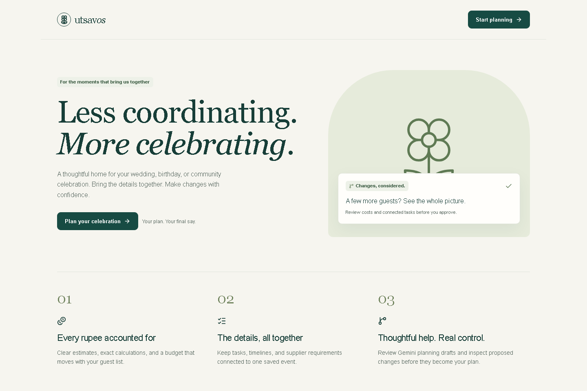
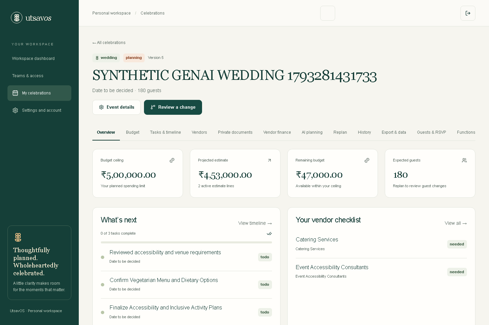
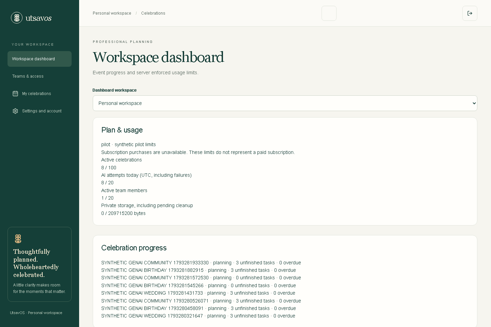
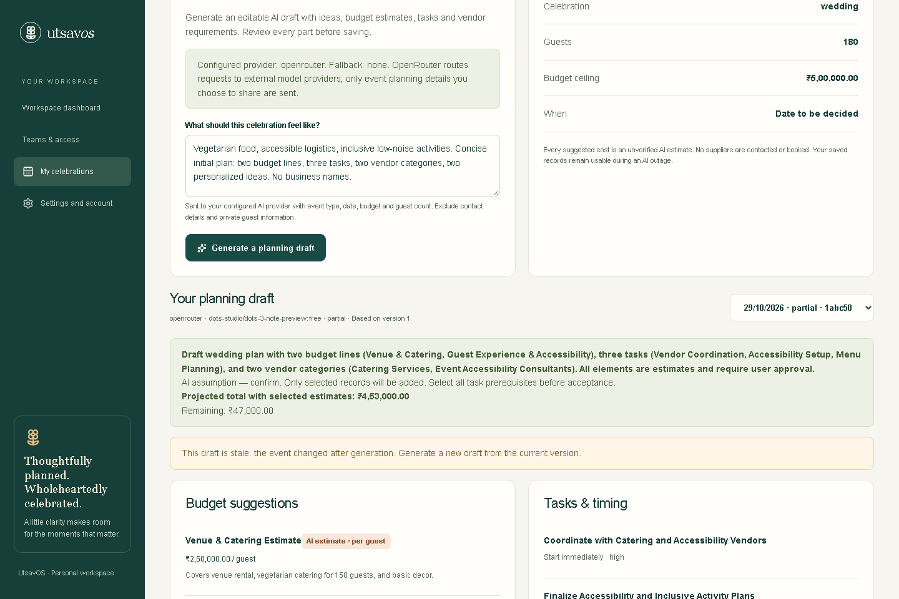
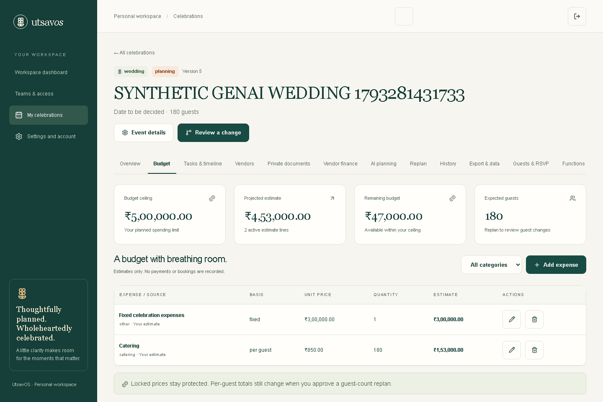
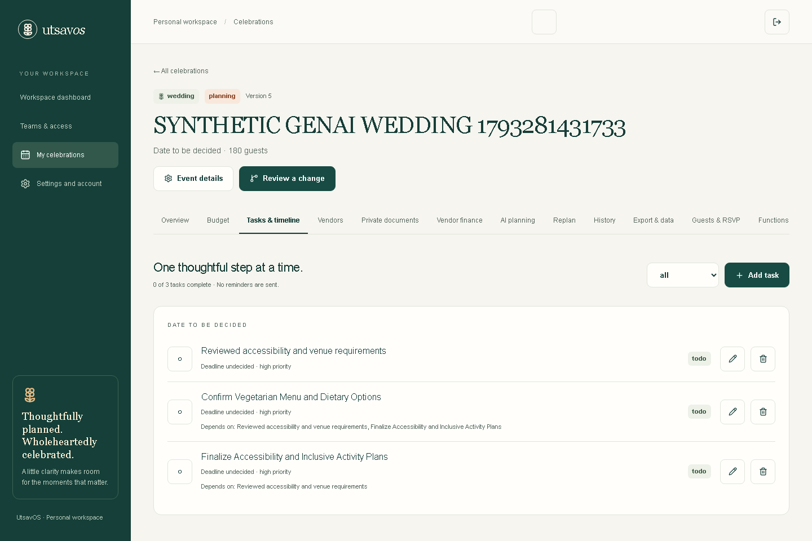
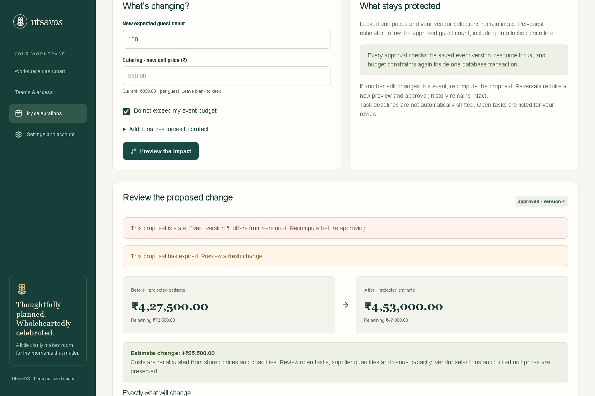
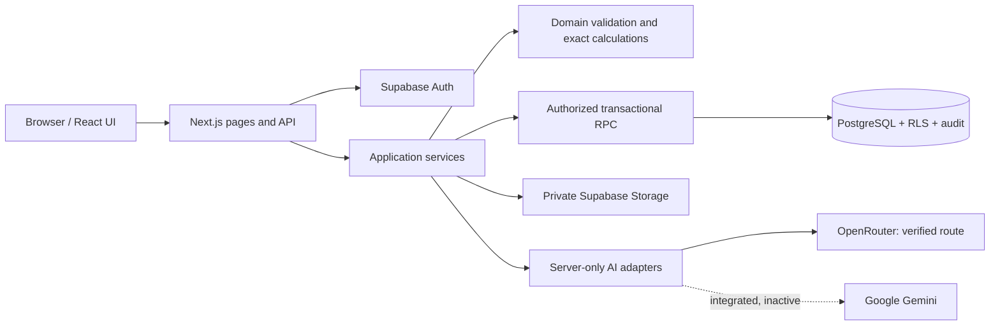

# UtsavOS

**AI-native event planning for weddings, birthdays, and community celebrations.**

Turn a personalized AI draft into a plan you can edit, budget, review and keep. When the guest count changes, see the consequences before approving them.

[Try the live app](https://utsavos.vercel.app) · [Watch the demonstration](https://www.youtube.com/watch?v=Z5bo9ydn7JE) · [Documentation](docs/README.md) · [Technical architecture](DEEP_TECHNICAL_ARCHITECTURE_UTSAVOS_V2.md) · [Challenge 5](docs/hackathon/SUBMISSION_CHECKLIST.md)



**Released on 29 October 2026.** [PR #1](https://github.com/YellankiKaushik/UtsavOS/pull/1) is merged and `main` is the production and submission branch. Genuine wedding, birthday and community AI journeys have passed production review, selective acceptance and persistence checks. Initial free-provider rate limits and later successful reruns remain documented. [Release evidence and limits →](docs/HACKATHON_RELEASE_HANDOFF.md)

## Watch UtsavOS in Action

[](https://www.youtube.com/watch?v=Z5bo9ydn7JE)

[Watch the full UtsavOS demonstration on YouTube](https://www.youtube.com/watch?v=Z5bo9ydn7JE). Owner-supplied video, verified anonymously as **“UtsavOS | AI-native Event Planning Platform”** by Kaushik. The screenshot above is a genuine production session with synthetic event data. YouTube playback opens outside GitHub; no original-video download is hosted in this repository.

## A plan that stays connected

Celebrations bring together budgets, guest lists, tasks, suppliers and multiple functions. When those details live in separate chats and spreadsheets, a small change can create uncertainty across the whole event.

UtsavOS keeps those decisions in one persistent workspace. AI suggests a starting point; the host chooses what becomes part of the plan. Deterministic calculations explain what a change costs, and an explicit approval controls what gets saved.

## Verified capabilities

| Area                 | What you can do                                                                                                   | Evidence and boundary                                                                                 |
| -------------------- | ----------------------------------------------------------------------------------------------------------------- | ----------------------------------------------------------------------------------------------------- |
| Event setup          | Create weddings, birthdays and community events; set guests, budget, preferences and optional dates/time zones    | Core production journey verified                                                                      |
| Structured AI plans  | Generate budget suggestions, tasks, vendor categories and personalized ideas; edit and selectively accept records | Genuine OpenRouter production verification; suggestions are unverified estimates                      |
| Exact budgets        | Track fixed, per-guest and per-unit expenses as integer paise                                                     | Domain/database tests and production golden scenario; no payment execution                            |
| Change-impact review | Preview guest-count/catering changes, preserve locked unit prices and approve an atomic update                    | Production preview, approval, refresh and history verified                                            |
| Tasks and vendors    | Manage status, dependencies, deadlines and unconfirmed vendor requirements                                        | Core production flow verified; no delivered reminders or supplier booking                             |
| Multiple functions   | Organize ceremonies, receptions or other event functions; associate tasks, expenses and vendors                   | Implemented; local/native/hosted evidence; rollout flag enabled in the release                        |
| Guests and RSVP      | Manage guests and scoped, revocable RSVP links                                                                    | Hosted/manual and transaction tests; invitation messaging is not provided                             |
| Teams and roles      | Delegate event access with role, assignment and approval boundaries                                               | Local/native and hosted RPC verification; not every hosted role/UI permutation tested                 |
| Vendor finance       | Record quotations, commitments, invoices and payments, with overpayment/lock guards                               | Records only; no funds transferred or Stripe checkout                                                 |
| Private documents    | Store private PDFs and review source-linked quotation fields manually                                             | Hosted private upload/download and manual review verified; AI extraction remains disabled             |
| Workspace and data   | Inspect pilot limits, export event data and request eligible operational erasure/account review                   | Local/native/hosted evidence; full account/backup erasure and commercial operations remain incomplete |

P1 flags are enabled in the verified release but default off for a new local setup. See the [feature status matrix](docs/IMPLEMENTATION_STATUS.md) for evidence by module rather than treating every implemented feature as comprehensively production-tested.

## Why this approach is useful

- **Human-approved AI:** a generated suggestion never directly approves a financial change.
- **Exact, explainable money:** domain rules and PostgreSQL transactions calculate totals and enforce bounds.
- **Protected commitments:** locks, versions and idempotent commands guard approved work against conflicting edits.
- **One persistent workspace:** functions, tasks, vendor requirements and change history stay connected to the event.
- **Tenant isolation:** authenticated operations and database authorization protect workspace boundaries.

### A change you can check yourself

Using user-entered estimates of ₹300,000 fixed costs and ₹850 catering per guest:

| Guests | Projected total | Remaining from ₹500,000 |
| ------ | --------------- | ----------------------- |
| 150    | ₹427,500        | ₹72,500                 |
| 180    | ₹453,000        | ₹47,000                 |

The extra 30 guests add ₹25,500. Previewing changes no approved records; approval checks the saved event version and constraints again inside one transaction. These figures are a test scenario, not a vendor quotation. AI budget suggestions were excluded from this golden vector.

## Product gallery

These are **genuine production screenshots using isolated synthetic data**, not customer records or API fixtures. Account identity is hidden only for capture. Click an image to inspect it at full size. [Media provenance →](docs/assets/README.md)

| Workspace dashboard                                                                                                         | Saved AI planning draft                                                                                                                  |
| --------------------------------------------------------------------------------------------------------------------------- | ---------------------------------------------------------------------------------------------------------------------------------------- |
| [](docs/assets/dashboard.png) | [](docs/assets/ai-planning.png) |
| Pilot limits and progress; no paid subscription claim.                                                                      | Genuine saved output; no new model call was made for these captures.                                                                     |

| Exact event budget                                                                                                          | Tasks and timeline                                                                                                            |
| --------------------------------------------------------------------------------------------------------------------------- | ----------------------------------------------------------------------------------------------------------------------------- |
| [](docs/assets/budget.png) | [](docs/assets/timeline.png) |
| Fixed and per-guest estimates remain separately editable.                                                                   | Accepted suggestions become operational records.                                                                              |

[](docs/assets/change-impact.png)

The saved approved proposal remains inspectable. Its stale/expiry notices reflect that the event has advanced since the original preview; it cannot be approved again from that old state.

## How it works

1. Create a celebration and choose its event type.
2. Set guests, budget, preferences and any known date/time zone.
3. Generate a structured AI planning draft using the configured provider.
4. Review assumptions, edit suggestions and select what to accept.
5. Maintain your saved budgets, tasks and vendor requirements.
6. Preview a guest-count or catering-price change.
7. Approve a valid proposal after reviewing its exact effects.
8. Return to the persisted plan and audit history.

## Technology and architecture

| Layer                | Implementation                                                                          |
| -------------------- | --------------------------------------------------------------------------------------- |
| Web                  | Next.js App Router, React, TypeScript, Tailwind CSS and accessible Radix primitives     |
| Contracts and rules  | Zod, exact integer-paise arithmetic, task/dependency and change-impact rules            |
| Data and identity    | Supabase PostgreSQL, Auth, RLS, private Storage and transactional RPCs                  |
| AI                   | OpenRouter through the OpenAI SDK; direct Google Gemini adapter through `@google/genai` |
| Quality and delivery | Vitest, native PostgreSQL concurrency tests, Playwright, GitHub Actions and Vercel      |



AI output passes JSON, schema and domain validation before draft persistence. Accepted records and financial approvals use authenticated application commands and database authorization; the model has no database credentials or authority to approve transactions. [Architecture guide](docs/ARCHITECTURE.md) · [Complete V2 design](DEEP_TECHNICAL_ARCHITECTURE_UTSAVOS_V2.md)

## Getting started

Use **Node.js 24.16.0** and **npm 11.9.0**, matching the validated development environment. The package engine requires Node 24.x; dependencies are pinned in the lockfile.

```powershell
git clone https://github.com/YellankiKaushik/UtsavOS.git
cd UtsavOS
npm ci
if (-not (Test-Path .env.local)) { Copy-Item .env.example .env.local }
```

Configure your **own isolated Supabase project**, publishable key, Auth origin/callbacks and server-side provider credential. Apply all 15 forward migrations to that project after reviewing a dry run; never reset a hosted/customer database. Then:

```powershell
npm run dev
```

Open [localhost:3000](http://localhost:3000). Basic UI rendering does not establish that authenticated persistence or AI works without real configuration. [Complete setup and migration commands →](docs/SETUP.md)

### Configuration

Use [.env.example](.env.example); never commit `.env.local`. Safe release-aligned examples:

| Variable                                                                     | Purpose / safe example                                                                                           |
| ---------------------------------------------------------------------------- | ---------------------------------------------------------------------------------------------------------------- |
| `SUPABASE_URL`, `SUPABASE_PUBLISHABLE_KEY`                                   | Your project and publishable key; corresponding `NEXT_PUBLIC_` aliases are supported and must agree              |
| `APP_BASE_URL`                                                               | `http://localhost:3000` locally; exact canonical HTTPS origin when deployed                                      |
| `AI_PROVIDER_PRIMARY`, `AI_PROVIDER_FALLBACK`                                | `openrouter`, `none`                                                                                             |
| `OPENROUTER_API_KEY`, `OPENROUTER_MODEL_ID`                                  | Server-only credential; verified release model `dots-studio/dots-3-note-preview:free`                            |
| `OPENROUTER_REQUIRE_FREE`, `OPENROUTER_DISABLE_REASONING`                    | `true`, `true`; availability/capability must be checked before enabling                                          |
| `AI_REQUEST_TIMEOUT_MS`, `AI_PROVIDER_TIMEOUT_MS`, `AI_PROVIDER_MAX_RETRIES` | `45000`, `45000`, `1`; retries share the total deadline                                                          |
| `GEMINI_API_KEY`, `GEMINI_MODEL_ID`                                          | Optional direct adapter; supplied release credential returned 401, so no successful Gemini generation is claimed |
| `FEATURE_AI_GENERATION`                                                      | Enable only after your real configured route is verified                                                         |
| P1 `FEATURE_*` flags                                                         | Default false in the template; see [configuration and deployment](docs/DEPLOYMENT.md)                            |
| `FEATURE_DOCUMENT_EXTRACTION`                                                | Keep `false` until full hosted acceptance is separately verified                                                 |

Model aliases ending in `MODEL_DEFAULT` must agree with their `MODEL_ID` counterpart. The release uses strict structured output, `data_collection: deny`, zero prompt/completion price and no fallback. Models and free capacity can change. Never use a service-role secret as an application publishable key.

## Testing and release evidence

```powershell
npm run format:check
npm run lint
npm run typecheck
npm test
npm run build
npm run security:client
```

| Layer                         | Recorded release evidence                                                                                                                                                   |
| ----------------------------- | --------------------------------------------------------------------------------------------------------------------------------------------------------------------------- |
| Unit/integration regression   | 231 passed, 0 failed/skipped                                                                                                                                                |
| Native PostgreSQL concurrency | 22 scenarios passed at the release checkpoint; also exercised in CI                                                                                                         |
| Synthetic browser UI          | 28 cases passed at the release checkpoint; fixtures are not live provider results                                                                                           |
| Genuine hosted Preview        | 3 event-type acceptance journeys passed in the final bounded run                                                                                                            |
| Public production             | Initial suite: 1 passed / 2 rate-limit failures; separate affected rerun: 2 passed / 0 failures. All three types have successful generation/acceptance/persistence evidence |
| CI                            | `validate` and `supabase-platform`; format, lint, types, regression, native races, generated-contract consistency, build, browser tests and real Docker Supabase checks     |

Counts describe separate, overlapping runs and must not be added into a grand total. This documentation work makes no new model requests. [Testing guide](docs/TESTING.md) · [Retained AI failures and successful reruns](docs/hackathon/AI_RELEASE_VERIFICATION_2026-10-29.md) · [CI](https://github.com/YellankiKaushik/UtsavOS/actions/workflows/ci.yml)

## Security and reliability

Tenant-scoped sessions, RLS and narrow transactional RPCs enforce access independently of the UI. Versions, locks, idempotency and transaction-coupled audit records protect mutations. Money crosses HTTP boundaries as canonical integer strings in paise. Private originals stay in private Storage. Server-only provider keys, bounded requests and validated drafts limit AI authority.

Free-tier rate limits and timeouts remain possible. Failed generation leaves approved planning records unchanged; saved plans stay manually editable. Real confirmation/recovery email delivery and email-link expiry/replay remain unverified because no controlled inbox was available. Global email confirmation remains enabled; an isolated synthetic reviewer workflow was verified instead. No certification, legal-compliance conclusion or availability SLO is claimed. [Security reporting](SECURITY.md)

## Documentation

Start with the [documentation index](docs/README.md): [setup](docs/SETUP.md), [architecture](docs/ARCHITECTURE.md), [OpenAPI contract](docs/api/openapi.yaml), [testing](docs/TESTING.md), [deployment](docs/DEPLOYMENT.md), [module guide](docs/modules/README.md), [implementation status](docs/IMPLEMENTATION_STATUS.md), [release handoff](docs/HACKATHON_RELEASE_HANDOFF.md) and [historical evidence](docs/README.md#historical-engineering-evidence).

## PromptWars Challenge 5

**Celebration & Event Planner:** persistent planning for weddings, birthdays and community events, with personalized GenAI suggestions and explainable changes. Actual runtime evidence uses OpenRouter; Codex assisted implementation, debugging, testing and release preparation. No Antigravity contribution or organizer tool-eligibility approval is claimed.

Submit the public repository's default **`main`**: [YellankiKaushik/UtsavOS](https://github.com/YellankiKaushik/UtsavOS), plus the [live app](https://utsavos.vercel.app) and [verified demonstration](https://www.youtube.com/watch?v=Z5bo9ydn7JE). The owner must still provide a published LinkedIn post URL and manually select/submit the official form. No submission receipt, award or score improvement is claimed. [Submission checklist](docs/hackathon/SUBMISSION_CHECKLIST.md) · [Copy-ready LinkedIn draft](docs/hackathon/LINKEDIN_POST.md) · [Organizer evidence](docs/hackathon/ORGANIZER_REQUIREMENTS.md)

## Limits and roadmap

P0 planning has bounded production verification. P1 modules are implemented with different evidence scopes as listed above. AI quotation extraction remains disabled; billing has an offline reconciliation foundation, with no verified checkout, payment processing or deployed reconciliation worker. Full account/backup erasure, operating retention policy and commercial readiness remain incomplete. P2 marketplace, messaging and advanced integrations are future work, not released capabilities.

## Contributing and licensing

Read [CONTRIBUTING.md](CONTRIBUTING.md) before proposing a change and [SECURITY.md](SECURITY.md) for private vulnerability reports. Main requires a PR, passing `validate`/`supabase-platform` checks and resolved conversations; force pushes/deletion are blocked. No impossible second-maintainer approval is required.

No `LICENSE` file is present. This repository does not currently declare an open-source license; selecting one requires the owner's explicit decision. No license rights have been invented for source, screenshots or third-party components.

---

[Plan a celebration](https://utsavos.vercel.app) · [Watch UtsavOS](https://www.youtube.com/watch?v=Z5bo9ydn7JE) · [Explore the engineering](docs/README.md)
