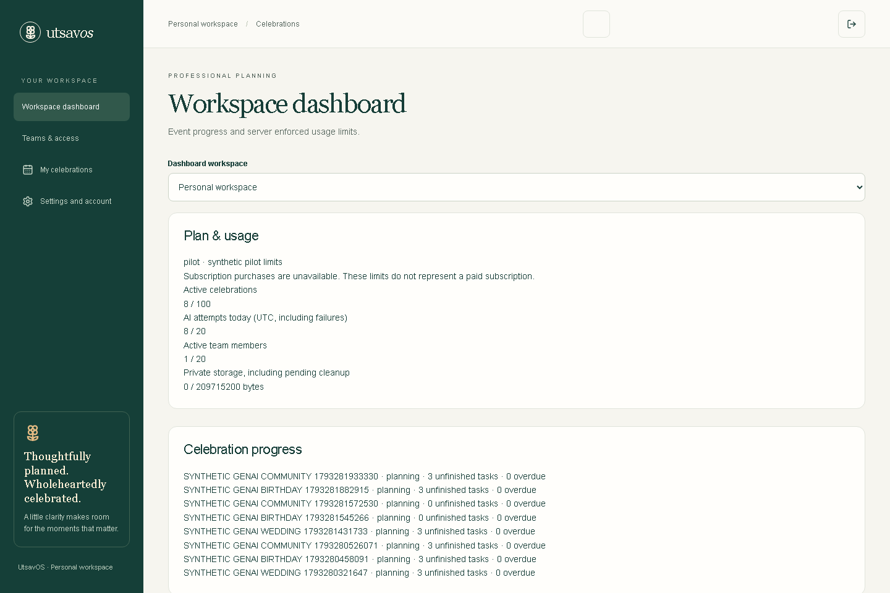
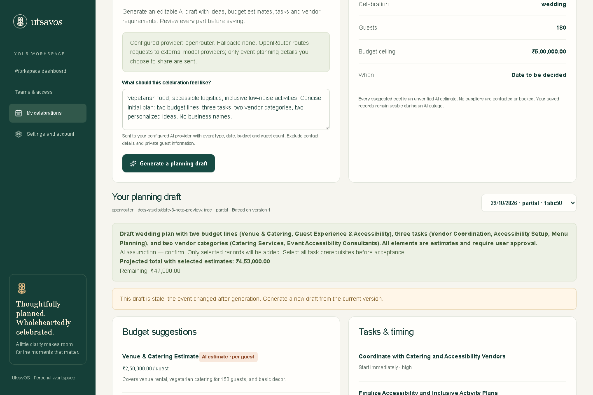
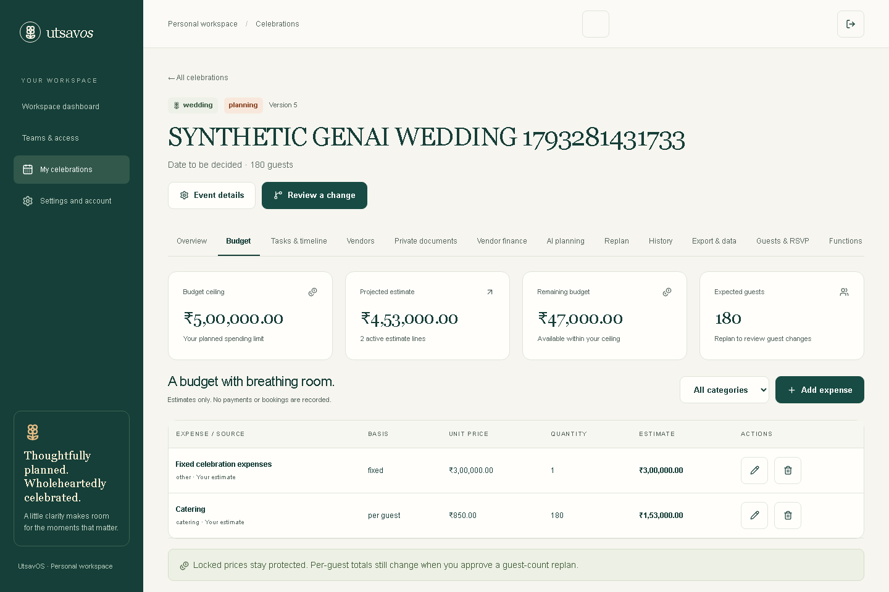
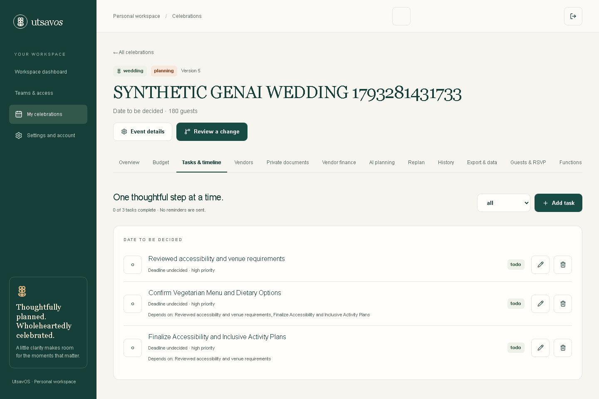
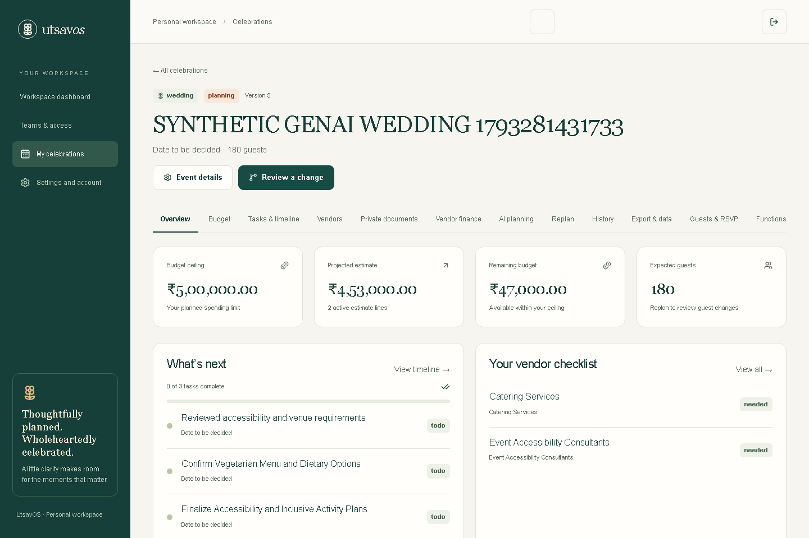

# UtsavOS product overview

UtsavOS is an open-source event-planning application for weddings, birthdays, and community celebrations. It brings budgets, tasks, vendors, and reviewable plan changes into one place.

The public website is a standalone Vite showcase. It uses invented examples, browser-local state, and no authentication, application API, Supabase, or AI provider. The original full-stack Next.js application is preserved for self-hosting; developers configure their own Supabase backend and may optionally connect their own AI provider.

## Created and maintained by

Created and maintained by **Yellanki Kaushik**. Development assistance: **OpenAI Codex**. The project is MIT licensed for materials the owner has rights to license. Third-party dependencies and media keep their own licenses; the UtsavOS name and marks are not licensed for trademark use.

## Planning approach

The full-stack application treats generated text as a draft, not an instruction. A person reviews, edits, and selectively accepts suggestions. Deterministic domain rules calculate budgets in integer paise. A guest-count or catering change can be previewed before it is explicitly approved and saved. The model itself cannot approve financial changes or access database credentials.

The static showcase demonstrates this review-oriented planning flow with bundled synthetic examples. Its sample suggestions are illustrative data, not live model output.

## Full-stack planning journey

1. Create a celebration and select its event type.
2. Set guests, budget, preferences, and any known date or time zone.
3. Optionally generate a structured planning draft with the provider you configured.
4. Review assumptions, edit suggestions, and select the records to accept.
5. Maintain saved budgets, tasks, vendors, and event functions.
6. Preview the impact of a guest-count or catering-price change.
7. Approve a valid proposal after checking its exact effects.
8. Return to the persisted plan and its history.

## Original application capabilities

These capabilities describe the preserved full-stack source. They do not imply that the public showcase currently connects to a backend or model.

| Area                   | Full-stack application scope                                                               | Boundary                                                                                         |
| ---------------------- | ------------------------------------------------------------------------------------------ | ------------------------------------------------------------------------------------------------ |
| Event setup            | Weddings, birthdays, community events, guests, budgets, preferences, dates, and time zones | Planning records belong to the self-hoster's Supabase project                                    |
| AI planning            | Structured draft suggestions for tasks, vendor categories, budgets, and ideas              | Bring your own key; availability, pricing, and output quality depend on the selected provider    |
| Budgets and replanning | Fixed, per-guest, and per-unit estimates; preview and approve change impact                | Estimates are not vendor quotations; approval is transactional                                   |
| Tasks and functions    | Task status, deadlines, dependencies, vendors, and event functions                         | No supplier booking or delivered reminders                                                       |
| Guests and teams       | Scoped workspaces, roles, invitations, and RSVP links                                      | Self-hosted configuration and email delivery are required                                        |
| Vendor finance         | Quotations, commitments, invoices, and payment records                                     | Records only; no money transfer or checkout                                                      |
| Documents and data     | Private document storage, exports, and event data lifecycle tools                          | Extraction is disabled; full account, backup, retention, and restore operations are not supplied |

See the [module guides](modules/README.md) and the dated [implementation evidence matrix](archive/reports/IMPLEMENTATION_STATUS.md) for scope and test boundaries.

## Origin and limits

UtsavOS was originally built for PromptWars Challenge 5. The preserved [challenge materials](hackathon/PROJECT_DESCRIPTION.md) and archived [release handoff](archive/reports/HACKATHON_RELEASE_HANDOFF.md) document that history.

This project does not provide vendor bookings, delivered reminders, checkout, payment processing, or an active marketplace. AI quotation extraction remains disabled. Provider availability and free capacity can change, so manual planning remains usable when generation is unavailable. Self-hosters are responsible for operating their own services, retention, backups, and recovery; no legal-compliance certification or availability SLO is claimed.

## A checkable budget example

For entered estimates of ₹300,000 fixed costs and ₹850 catering per guest:

| Guests | Projected total | Remaining from ₹500,000 |
| ------ | --------------: | ----------------------: |
| 150    |        ₹427,500 |                 ₹72,500 |
| 180    |        ₹453,000 |                 ₹47,000 |

The additional 30 guests add ₹25,500. This is a deterministic example, not an AI suggestion or vendor quote.

## Historical product images

The gallery below is retained documentation of the original full-stack interface. These images are not screenshots of the current public static showcase. The [media provenance note](assets/README.md) describes their source and the synthetic data used.

| Earlier workspace                                                            | Saved planning draft                                                              |
| ---------------------------------------------------------------------------- | --------------------------------------------------------------------------------- |
|  |  |

| Earlier budget                                                            | Earlier tasks and timeline                                           |
| ------------------------------------------------------------------------- | -------------------------------------------------------------------- |
|  |  |

[Earlier change-impact view](assets/change-impact.png) · [Earlier application landing page](assets/landing.png) · [Earlier event overview](assets/overview.png)

The owner-supplied [UtsavOS walkthrough](https://www.youtube.com/watch?v=Z5bo9ydn7JE) is hosted on YouTube. It documents the project and may show the original full-stack interface; it is not a deployment capture of the current static website. No video file is bundled here.

## Further reading

- [Architecture and data boundaries](ARCHITECTURE.md)
- [Self-hosting setup](SETUP.md), [deployment](DEPLOYMENT.md), and [testing](TESTING.md)
- [Static showcase verification](STATIC_SHOWCASE_RELEASE_VERIFICATION.md)
- [Historical release and test evidence](archive/reports/README.md)
