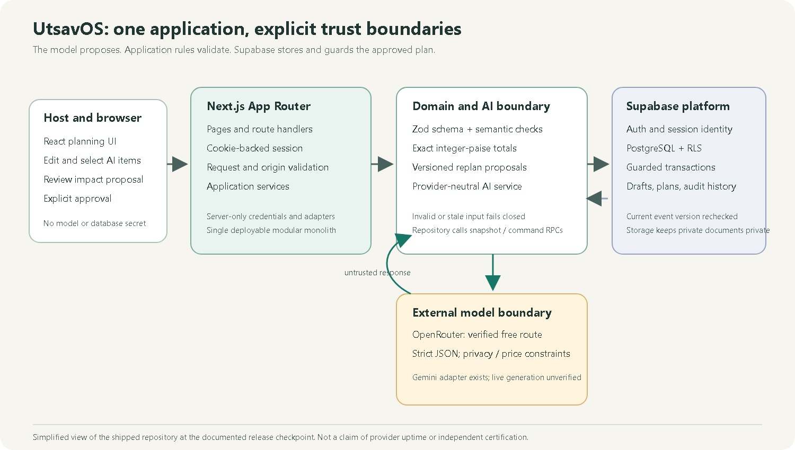
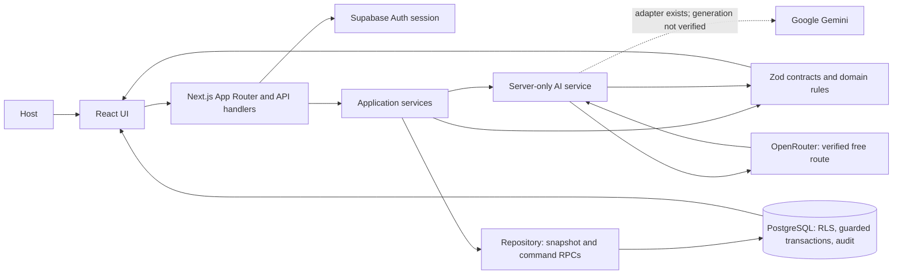
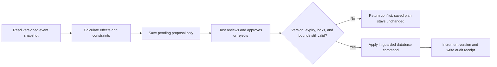
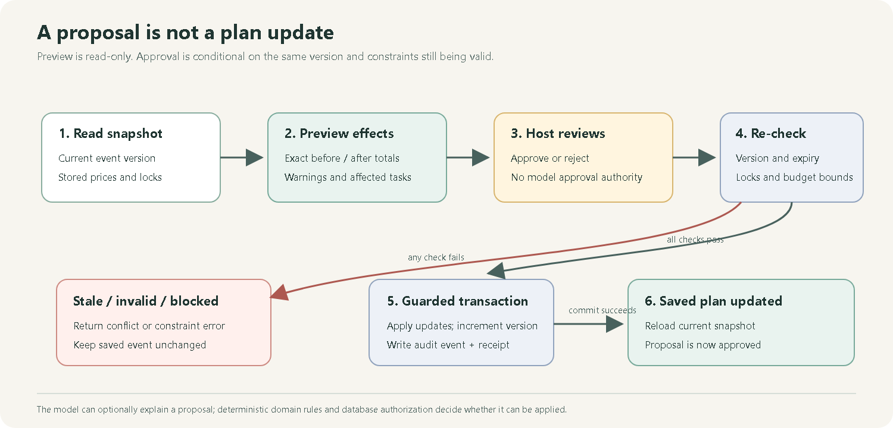

# Building UtsavOS: Human-Reviewed AI, Exact Budgets, and Approved Replanning

_A full-stack case study in turning weddings, birthdays, and community events into persistent plans—with structured AI drafts, integer-paise calculations, Supabase authorization, and explicit approval for consequential changes._

Planning an event is a chain of connected decisions. Add thirty guests to a wedding and catering quantities change; that can affect the budget, venue capacity, supplier commitments, task deadlines, and the host’s confidence in the plan. In a spreadsheet, those assumptions are easy to split across tabs. In a group chat, the latest decision can be hard to distinguish from an old one.

I built [UtsavOS](https://utsavos.vercel.app) to make those decisions easier to inspect and keep together. It supports weddings, birthdays, and community celebrations. A host can ask AI for a starting plan, edit it, choose which suggestions to save, maintain the resulting records, and preview a consequential change before approving it. The [source and release evidence are public on GitHub](https://github.com/YellankiKaushik/UtsavOS); the [walkthrough](https://www.youtube.com/watch?v=Z5bo9ydn7JE) shows a real production session with synthetic event data.

This is not a claim that AI can plan an event on its own. The engineering problem is how to make AI useful while keeping the host, deterministic domain rules, and database in charge of the plan.


_The overview is a read-only production capture using an isolated synthetic event, not customer data. [Media provenance](../assets/README.md)._

## From a challenge prompt to a planning workspace

UtsavOS began as my implementation of PromptWars Challenge 5, “Celebration & Event Planner.” The brief called for budgets, timelines, vendor checklists, personalized AI ideas, and support for different celebrations. A chatbot could suggest a theme or menu, but a host also needs to edit those ideas, connect them to tasks and expenses, and return to the saved plan.

That distinction shaped the product. The model does not write directly to the database. It returns a draft with budget suggestions, tasks, vendor requirements, ideas, assumptions, questions, and warnings. The user reviews and selectively accepts records. Budget totals come from domain and database calculations, while re-planning has a separate preview and approval path.

I used OpenAI Codex as a development assistant for implementation, debugging, testing, and release preparation. I do not claim Google Antigravity use, organizer approval of the tool choice, a competition result, or a prize. The organizer’s public tool guidance is documented as conflicting in the [requirements record](../hackathon/ORGANIZER_REQUIREMENTS.md); that question is separate from what the code does.

## The product journey: draft, review, save, revisit

A host creates a wedding, birthday, or community event and enters the details currently known: guest count, a budget ceiling, preferences, and any date or time-zone information. UtsavOS sends the event context and the preferences the host chose to share to the configured AI provider. It does not need a guest contact list to generate a planning draft.

The returned suggestions are editable. A host can change a title or estimate, select useful tasks and vendors, and leave the rest unaccepted. Accepted items become ordinary event records that can be revised through the application’s commands; later planning starts from the current saved snapshot.


_Accepted suggestions become editable task records in the synthetic event workspace._

For the financial example used in the release tests, the event starts with ₹300,000 in fixed expenses and catering at ₹850 per guest. At 150 guests, the projected total is ₹427,500. At 180 guests, it is ₹453,000, leaving ₹47,000 from a ₹500,000 ceiling. The host can inspect this result as a proposed change before approval. These are test inputs, not a supplier quote or a promise that AI-generated prices are accurate.


_The screenshot shows previously saved genuine model output. It was captured without a new AI request; the suggested amounts remain unverified estimates._

## One deployable, explicit boundaries

UtsavOS is a modular monolith: one Next.js application contains the pages, API route handlers, application services, domain rules, and provider adapters. Supabase Auth supplies identity and PostgreSQL stores the structured event state. The client does not speak to the model provider with a secret key or get authority to approve changes.

The application follows recognizable boundaries even though it is deployed as one app. React components collect user input and display snapshots, drafts, and proposals. Route handlers parse and bound requests, check the caller’s session and origin, then call application services. Domain modules own contracts, task dependencies, date rules, integer-paise arithmetic, and re-planning calculations. Repository functions call narrow Supabase RPCs. Database functions re-check membership, versions, limits, locks, idempotency, and financial invariants while writing the audit record.

This modular monolith keeps related rules and approval transactions together without adding network boundaries between every module. Provider adapters are separate because model APIs vary; planning and financial rules do not need independent services at this scope.



_The PNG is rendered from the companion SVG and mirrors the Mermaid diagram below. Arrows show application calls, not a claim that any provider is available continuously._



The diagram describes the deployed boundary, not a target architecture copied from an early plan. The longer V2 architecture document remains useful as a design record, but the article’s implementation claims are checked against the current source and release evidence.

## Treat model output as untrusted input

The planning service prepares a small context: event type, date status and date, time zone, guest count, currency, budget ceiling, and the preferences the host entered. The system prompt tells the model to treat that context as data, return only the requested schema, avoid claiming verified prices or vendor availability, exclude personal guest details, and make every item a draft that needs approval. The prompt is versioned as `event-plan.v2`; provenance records the requested and actual model, routing provider, token usage, latency, attempt count, and reported cost when supplied.

In production the configured route was OpenRouter with `dots-studio/dots-3-note-preview:free`. The adapter uses OpenAI-compatible chat completions, but it checks the model catalogue for structured-output support and the free-price constraint before sending a request. The request asks for strict JSON Schema output, caps completion length, disables provider-level fallbacks, sets `data_collection: deny`, and applies a zero prompt/completion price cap. The application-level fallback is `none` in the verified release. A successful route is still not guaranteed: free capacity and provider availability can change.

The route is an adapter behind a provider-neutral `ModelRequest`/`ModelResponse` interface. A direct Gemini adapter also exists, but the configured Gemini credential returned HTTP 401 during release verification, so no successful Gemini planning generation is claimed. Having an adapter in source is not the same as having a working production route.

Structured output helps bound shape; it does not establish that a proposal is sensible. After JSON parsing, the application validates the schema and then checks semantic rules: event type must match, draft IDs must be unique, task dependencies must form a valid acyclic graph, a TBD event cannot receive invented dates, planning deadlines cannot follow the event, and pricing quantity must match the selected pricing basis. It also rejects certain unsupported claims and runs the suggestions through the same deterministic budget calculation used by the application.

The service fails closed when either parsing or schema validation fails:

```ts
const parsed = schema.safeParse(raw);
if (!parsed.success) {
  const error = new ProviderError(provider, "invalid_output");
  error.validationStage = "schema";
  throw error;
}
```

This is a shortened excerpt from [`src/infrastructure/ai/service.ts`](https://github.com/YellankiKaushik/UtsavOS/blob/main/src/infrastructure/ai/service.ts). Semantic checks run separately in [`src/domain/ai-contract.ts`](https://github.com/YellankiKaushik/UtsavOS/blob/main/src/domain/ai-contract.ts). In the UI, the host can inspect assumptions, edit selected fields, choose which records to accept, and review the selected budget before saving. The database checks the draft version and expiry again, generates its own record IDs, validates selected IDs, and marks the draft accepted or partial.


_The displayed totals come from saved synthetic records and deterministic arithmetic. AI budget suggestions were intentionally excluded from the release’s golden budget vector._

## Exact money belongs to code, not a completion

Money crosses the application boundary as canonical integer strings in paise and is calculated internally with `bigint`. For a fixed line, quantity is one; for a per-guest line, quantity is the approved guest count; for a per-unit line, the application requires an explicit integer quantity. The total is the sum of active lines, and the remaining amount is the ceiling minus that total.

The core calculation is deliberately small:

```ts
const quantity =
  item.pricingBasis === "fixed"
    ? 1n
    : item.pricingBasis === "per_guest"
      ? count(guests)
      : count(item.quantity ?? -1);

return assertMinor(unit * quantity);
```

This logic is from [`src/domain/money.ts`](https://github.com/YellankiKaushik/UtsavOS/blob/main/src/domain/money.ts). The example budget is simple enough to audit by hand:

```text
fixed:      ₹300,000
catering:   ₹850 × 150 = ₹127,500
at 150:     ₹427,500 projected; ₹72,500 remaining
at 180:     ₹453,000 projected; ₹47,000 remaining
change:     ₹25,500
```

The model can suggest a cost estimate, but the application labels it unverified and never treats it as an authoritative quotation. Replanning uses stored prices and quantities. Locked unit prices are preserved; per-guest totals can still change when the guest count changes, and the proposal warns the host to confirm supplier commitments. The product records vendor payments but does not execute transfers or charge a card.

## Preview first; approve against current state

Changing guest count or a catering unit price follows a separate proposal path. UtsavOS reads a versioned snapshot, computes before-and-after totals, checks locked resources and the budget constraint, identifies affected open tasks, and saves a proposal—not a changed plan. A capacity warning remains because a budget calculation cannot prove that a venue or supplier can accommodate more guests.

The host sees the effects and must explicitly approve or reject the proposal. On approval, the database checks that the proposal is still pending and unexpired, its base version still matches the event, the selected operation IDs match the proposal, locked resources remain protected, and the recalculated final total matches the preview. It then applies the updates, increments the event version, marks the proposal approved, writes an audit event, and saves an idempotency receipt in the same command transaction. Replayed identical commands can return the earlier result; a changed request using the same key conflicts. A stale proposal cannot silently overwrite newer state.


_This read-only production capture shows a saved proposal. Its stale/expiry notices are intentional: an old proposal must not be approved again after the event advances._





_The change flow is separate from AI generation. No model is asked to calculate or approve this financial mutation._

## Supabase is part of the authorization boundary

The server creates a Supabase client per request using the publishable key and the caller’s cookie-backed session. It calls `auth.getUser()` before returning an authenticated application session. Cookies are HTTP-only and SameSite=Lax; production cookies are Secure. The project uses PostgreSQL Row Level Security and narrow RPCs so a hidden button is not the security boundary.

In the core migration, exposed planning tables have RLS enabled, broad direct table grants revoked, and authenticated reads constrained by workspace membership. Mutation privileges are not granted as a general table-write path. The public RPC wrappers run as invokers; private command functions are separately permissioned and check `auth.uid()`, event membership, versions, command keys, and invariants. This is an application design with tested boundaries, not a claim of independent security certification.

The same principle applies to provider keys: AI code is marked server-only and credentials are read from server configuration. The user-facing AI notice explains that event context and chosen preferences are sent to the configured provider; it asks users not to include contact details or private guest information. `data_collection: deny` is a request-level routing constraint, not a promise of zero data retention or a substitute for reviewing provider terms.

Private quotation PDFs and source anchors support manual review; hosted AI extraction remains disabled pending end-to-end acceptance. RSVP links are scoped and revocable, but the application does not send invitations. Security tests cover signed-out denial, invalid input, cookies, and tenant isolation—not every role/device combination or email-recovery flow.

## A larger product, with deliberately narrow claims

The codebase also includes multi-function events, guests and RSVP links, team roles, vendor quotes and payment records, private documents, workspace limits, exports, and lifecycle controls. Those modules are not blanket proof of commercial readiness.

Evidence varies by module: event functions have local, native, and hosted Preview checks; guest/RSVP flows do not provide invitation delivery; and team/vendor-finance commands lack coverage for every hosted role interface. Payment records do not transfer money, and Stripe checkout is off. Full account deletion, session revocation, managed backup retention, and recovery operations remain incomplete.

These qualifications matter because a UI route existing does not prove the complete operational workflow. The [implementation status matrix](../IMPLEMENTATION_STATUS.md) lists what is verified and where evidence stops.

## Testing means naming the boundary

The project uses several test layers. At the final application checkpoint, the regression run reported 231 passes, with no failed or skipped tests. The native PostgreSQL suite exercised 22 concurrency scenarios. The controlled browser suite covered 28 cases, including accessibility checks, keyboard interactions, and responsive layouts. These counts overlap in what they exercise and should not be summed into one inflated total.

Separate from those local and synthetic suites, genuine hosted tests exercised wedding, birthday, and community planning against the configured provider. The protected Preview passed all three journeys. The first production suite was not a clean 3/3: the wedding passed, while birthday and community requests hit rate limits. Those failed events remained unchanged. After cooldown, a bounded affected-event rerun passed both. That gives successful production generation, selective acceptance, and reload persistence evidence for all three event types—but not evidence that the original failures disappeared or that the free route has an availability guarantee.

The successful production calls used `dots-studio/dots-3-note-preview:free` through AtlasCloud. Recorded generation latencies were 17,325 ms for the wedding, 11,631 ms for the birthday rerun, and 20,436 ms for the community rerun. Each reported cost 0 for that call. The project’s 45,002 ms timeout exhausted the request deadline before a completion; diagnostics did not establish whether the time was spent in queueing, network, or inference. Another 15,547 ms failure remains unclassified. Quota inspection ruled out exhaustion of the observed daily allowance at that moment, but did not identify the exact rate limiter.

The implementation now records bounded failure categories and response-stage metadata without retaining raw prompt text or provider error bodies. Transient retry is bounded by a shared deadline; retries do not turn an uncertain provider into a reliable one. The 24-request live evaluation corpus was not run because the required allowance was not available. No paid model, synthetic fixture, or alternate route was used to replace the genuine failed calls. The full record is in the [AI release verification ledger](../hackathon/AI_RELEASE_VERIFICATION_2026-10-29.md).

GitHub Actions runs `validate` and `supabase-platform`; the latter uses a disposable local Docker Supabase stack. The production application was released via PR #1, while PRs #2 and #3 updated repository documentation. The latest source documentation checkpoint is `c3b8600` on protected `main`; the article’s own PR will have its own merge SHA. The main production app and the article branch do not get conflated: a documentation commit may trigger a Vercel rebuild, but it does not itself add application behavior.

## What was hard—and what remains unknown

The configured Gemini key returned 401. OpenRouter provided successful free-route generations but also rate limits and an incomplete 45-second request. The affected events stayed unchanged, and later successful reruns were recorded separately. Diagnostics did not identify the timeout’s upstream cause or the exact rate limiter. Schema validation also could not replace domain rules for dependencies, deadlines, or quantities; parsed output still needed semantic checks.

Concurrency required a database decision point: proposals can become stale after preview, so approval locks the event row, checks version and idempotency, recalculates constraints, then commits with an audit record. Native PostgreSQL race tests and hosted approval checks cover different parts of this path. Real email delivery and expired/replayed-link behavior remain unverified without a controlled inbox; extraction, checkout, invitation delivery, marketplace booking, account deletion operations, and managed backup recovery also remain incomplete.

## Deploying a verified release

The release path is GitHub → required CI → Vercel → Next.js → Supabase and the selected AI provider. Pull requests create protected Previews; `main` feeds the public application. Required checks are `validate` and `supabase-platform`, alongside branch protection and review. Production uses the canonical `APP_BASE_URL`, exact Supabase callbacks, a server-only OpenRouter credential, free-model price/privacy controls, and flags that keep incomplete extraction and billing disabled. The application was tested on its canonical domain; later documentation changes did not alter runtime settings or migrations.

For a local copy, follow [`docs/SETUP.md`](../SETUP.md), use the pinned Node/npm versions from the repository, configure a separate Supabase project, and review migrations before applying them. A page that renders locally is not evidence that sign-in, RLS, real model access, provider pricing, or persistence works against your own configuration.

## What I would improve next

Next I would measure provider stages and broaden model evaluation only when an explicit request budget is available, then define when generation should pause during instability. I would complete controlled-inbox tests, account deletion and backup-retention operations, and billing only when the needed service accounts and verification paths are ready. Product work could clarify uncertain estimates, improve day-of coordination, finish hosted quotation review, and extend accessibility testing with real keyboard and screen-reader use. No dates are promised; some work depends on operational decisions as well as code.

## Engineering lessons from the build

1. **Treat generated text as untrusted input.** UtsavOS parses structured output, validates it with Zod, then checks dependency, date, quantity, and claim rules before saving a draft.
2. **Keep estimates separate from authority.** AI budget suggestions are labeled unverified; exact totals use stored unit prices and integer-paise arithmetic.
3. **Make consequential updates reviewable.** A guest-count change first becomes a proposal. The database validates the current event version and recalculates before it commits.
4. **Put authorization where data changes.** RLS and guarded RPCs enforce boundaries even if a client route or button is bypassed.
5. **Describe tests by what they actually exercised.** A fixture suite, native race test, hosted AI call, and production persistence check answer different questions.
6. **Keep failure evidence.** The initial rate limits and timeout belong beside the later successes; otherwise the deployment record would overstate reliability.
7. **Document what is still off.** Disabled extraction and checkout, unverified email delivery, and missing managed recovery operations are product facts, not footnotes to hide.

## Closing

UtsavOS is a persistent event-planning workspace built around a modest division of responsibility: AI helps create a draft, the host decides what to accept, domain code calculates, and the database guards the saved state. The hard part was not asking a model to produce a list. It was putting that list inside a system where money, permissions, concurrent changes, and failure behavior remain legible.

You can explore the [live application](https://utsavos.vercel.app), watch the [UtsavOS demonstration](https://www.youtube.com/watch?v=Z5bo9ydn7JE), or read the [source repository](https://github.com/YellankiKaushik/UtsavOS). I’d welcome thoughtful feedback from developers, event planners, and anyone building human-reviewed AI products—especially on the draft review and change-impact flow.

## Technical references

- [Next.js App Router](https://nextjs.org/docs/app) and [Route Handlers](https://nextjs.org/docs/app/getting-started/route-handlers)
- [Zod basic usage and `safeParse`](https://zod.dev/basics)
- [Supabase server-side Auth](https://supabase.com/docs/guides/auth/server-side) and [PostgreSQL Row Level Security](https://supabase.com/docs/guides/database/postgres/row-level-security)
- [OpenRouter structured outputs](https://openrouter.ai/docs/guides/features/structured-outputs) and [provider routing](https://openrouter.ai/docs/guides/routing/provider-selection)
- [PostgreSQL transaction isolation](https://www.postgresql.org/docs/current/transaction-iso.html)

---

**Editorial note:** This article is an engineering account of the implementation and release evidence cited above. The author should review first-person attribution and the final Medium rendering before publishing. The article has not been published on Medium.
